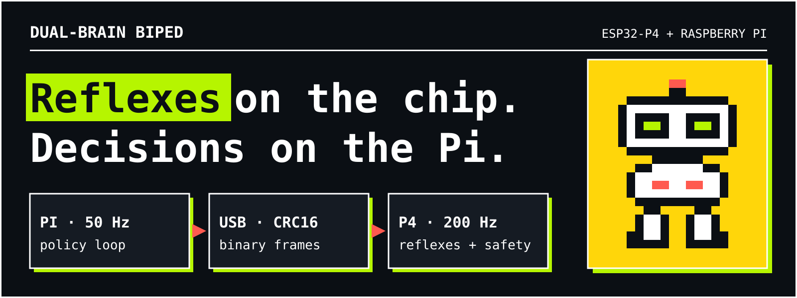
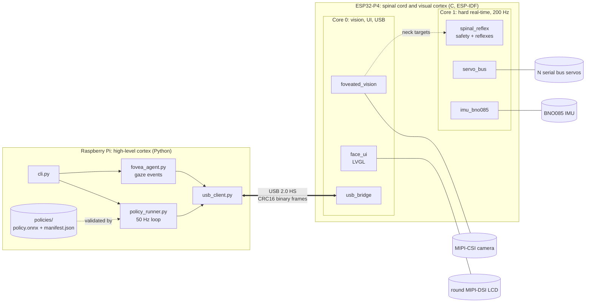

# Dual-Brain Desktop Biped

Firmware and onboard software for a small two-legged robot. An ESP32-P4 chip handles fast reflexes, vision and the screen. A Raspberry Pi runs the slower decision loop.

<p align="center">
  <picture>
    <source media="(prefers-color-scheme: light)" srcset="docs/screenshots/hero-light.svg">
    
  </picture>
</p>

**Why it exists:** a walking robot needs split-second safety and reflexes that cannot wait for a network round trip, and a flexible place to run a learned policy. This design gives each its own processor.

**Who it's for:** builders of the robot and the teammate who trains its policy. You can drop in a trained `policy.onnx` and test everything else on a laptop with no hardware.

**Try it in one minute:** run `python tools/bench_test.py` (see [Quick start](#quick-start-no-hardware)).

> **Status:** the Pi runtime, protocol generator and simulator are tested and working.
> The ESP32-P4 firmware is written but **has not yet been compiled or run on hardware**.
> See [Project status](#project-status).

## Contents
- [Architecture](#architecture)
- [Key design ideas](#key-design-ideas)
- [Repository layout](#repository-layout)
- [Quick start (no hardware)](#quick-start-no-hardware)
- [Running on the robot](#running-on-the-robot)
- [Changing the joint list](#changing-the-joint-list)
- [Wire protocol](#wire-protocol)
- [Safety model](#safety-model)
- [Policy bundles](#policy-bundles)
- [Project status](#project-status)

## Architecture



| | ESP32-P4 | Raspberry Pi |
|---|---|---|
| **Role** | Spinal cord and visual cortex | Onboard runtime and high-level policy |
| **Rate** | 200 Hz control loop on Core 1 | 50 Hz policy loop |
| **Owns** | Servos, IMU, camera, screen | Policy, CLI, perception hooks |
| **Language** | C (ESP-IDF) | Python 3.11+ with `uv` |

The Pi sends target joint angles at 50 Hz. The ESP32-P4 runs four control ticks per command. On each tick it smooths targets, enforces limits, applies sub-10 ms reflexes, and reports state back at 200 Hz. The Pi is the only way commands arrive, and the ESP32-P4 is the only thing that touches the servos.

## Key design ideas

- **No hard-coded joint count.** `NUM_JOINTS` and all joint data come from one file,
  [`shared/robot_spec.yaml`](shared/robot_spec.yaml). A generator emits the C header and Python bindings, so
  packet sizes, structs, limit tables and safety loops resize automatically.
- **Safety lives on the ESP32-P4.** Hard angle and current limits, slew limits, and the watchdog run on the
  microcontroller and cannot be bypassed by the Pi.
- **Reflexes beat the network.** Looming-object flinch and ankle brace respond in under 10 ms, locally, by adding temporary
  offsets on top of whatever the Pi commanded.
- **Bring-up without a model.** `neutral_hold` and `manual_jog` modes let you test hardware, reflexes and the screen before any
  trained policy exists.
- **Contract-validated policies.** A teammate drops a `policy.onnx` and `manifest.json` into `policies/`; the runtime refuses to
  enable motors unless the manifest matches the robot spec exactly.
- **Testable without hardware.** `tools/sim_bridge.py` emulates the ESP32-P4's USB protocol so the whole Pi side runs on a laptop.

This repo contains **no reinforcement-learning training, physics simulation or model-export code**. It only provides the runtime interface.

## Repository layout

```
shared/               Single source of truth
  robot_spec.yaml       joints, limits, reflexes, gaze PID, bus settings
  protocol.yaml         packet definitions
  generate_bindings.py  emits the C header and Python bindings
firmware_esp32p4/     ESP-IDF project (C)
  components/           servo_bus, imu_bno085, spinal_reflex, foveated_vision,
                        face_ui, usb_bridge, generated
  main/                 app_main.c (task layout), board_display.c
brain_pi/             Raspberry Pi runtime (Python)
  src/                  policy_runner, usb_client, fovea_agent, cli
  policies/             drop-in policy bundles + manifest contract
tools/                sim_bridge.py, bench_test.py, servo_zero_calibrator.py
Makefile              convenience targets (each is a plain python command)
```

## Quick start (no hardware)

Requires Python 3.11+ and `pyyaml` and `pyserial` (or run `uv sync` in `brain_pi/`).

```bash
python shared/generate_bindings.py    # or: make generate
python tools/bench_test.py            # or: make bench-test
```

`bench-test` starts the simulator, runs the Pi runtime in `neutral_hold` for 5 seconds, and checks that:

- action packets flow at about 50 Hz,
- state packets arrive at 150 Hz or more,
- there are no CRC or length errors,
- the latest action sequence number is acknowledged.

Windows does not ship `make`; every Makefile target is a one-line `python` command you can run directly.

## Running on the robot

Install and run on the Pi:

```bash
cd brain_pi && uv sync                 # add --extra onnx to run policies
export PYTHONPATH=src
python -m cli info                     # print joint table and packet sizes
python -m cli run --mode neutral_hold --link serial:/dev/ttyACM0
```

| Command | Purpose |
|---|---|
| `run --mode neutral_hold\|manual_jog\|onnx\|auto` | 50 Hz control loop (`auto` uses a valid policy if found, otherwise neutral hold) |
| `jog` | Interactive manual joint offsets |
| `monitor` | Live telemetry |
| `estop` | Cut servo torque (latched) |
| `validate-policy [path]` | Check a policy bundle against the robot spec |

The `--link` option takes `serial:/dev/ttyACM0` (real ESP32-P4 over USB) or `tcp://127.0.0.1:5555` (simulator).

Firmware: see [`firmware_esp32p4/README.md`](firmware_esp32p4/README.md) (ESP-IDF 5.4+, `make firmware-build`).
Servo zeroing: `tools/servo_zero_calibrator.py`.

## Changing the joint list

1. Edit `joints:` in `shared/robot_spec.yaml`.
2. Run `make generate`.
3. Rebuild and reflash the ESP32-P4.

The Pi refuses to start if the generated bindings are stale, and both ends reject frames from a build with a different joint count.
Joint order is the order in the list, so reordering invalidates any policy trained on the old order. The manifest check catches this.

## Wire protocol

Frames are little-endian and packed:

```
5A A5 | type u8 | length u16 | payload | CRC-16/CCITT-FALSE u16
```

| Packet | Direction | Rate | Contents |
|---|---|---|---|
| `StatePacket` | ESP32-P4 → Pi | 200 Hz | timestamp, IMU quaternion and gyro, per-joint position / velocity / current, active reflex bitmask, gaze target and lock |
| `ActionPacket` | Pi → ESP32-P4 | 50 Hz | sequence id, control mode, per-joint target angle, gaze override flag |
| `RoiFrame` | ESP32-P4 → Pi | up to 10 Hz | 64×64 grayscale crop around the gaze target (sent while locked) |

Control modes: `NEUTRAL_HOLD`, `ONNX_POLICY` (follow the Pi's targets, used for both policy output and manual jog), and `ESTOP`.
Full definitions are in [`shared/protocol.yaml`](shared/protocol.yaml). Sizes for the sample 6-joint robot are 116, 30 and 4112 bytes.

## Safety model

- **ESP32-P4 (last line of defense):** sanitise and clamp targets, slew-limit, add reflex offsets, clamp over-current joints,
  then apply the hard min/max limits last.
- **Watchdog:** no valid action for 100 ms means hold neutral.
- **E-stop is latched:** it clears only when a live Pi sends `NEUTRAL_HOLD`. A dead link never re-enables torque.
- **Pi side:** clamps and slew-limits again, falls back to `NEUTRAL_HOLD` on stale telemetry or any policy error, and enables
  `onnx` mode only after the manifest check passes.

## Policy bundles

Drop `policy.onnx` and `manifest.json` into `brain_pi/policies/`. The manifest declares joint names and order, control rate,
observation terms and action interpretation. The full contract is in
[`brain_pi/policies/README.md`](brain_pi/policies/README.md).

## Project status

| Part | Status |
|---|---|
| Generator, bindings, Pi runtime, simulator, bench test, calibrator | Working. Bench test passes at 200 Hz / 50 Hz with zero CRC errors |
| ESP32-P4 firmware | **Not yet compiled or run on hardware.** Expect build fixes and library API drift. Pin numbers are placeholders |
| ONNX policy path | Validation implemented, inference not yet exercised with a real model |
| H.264 video streaming, 2D PPA acceleration, ESP-DL detector | Not implemented (see the firmware README) |

Check servo register tables, current and limit values, and pin assignments before powering real servos.
